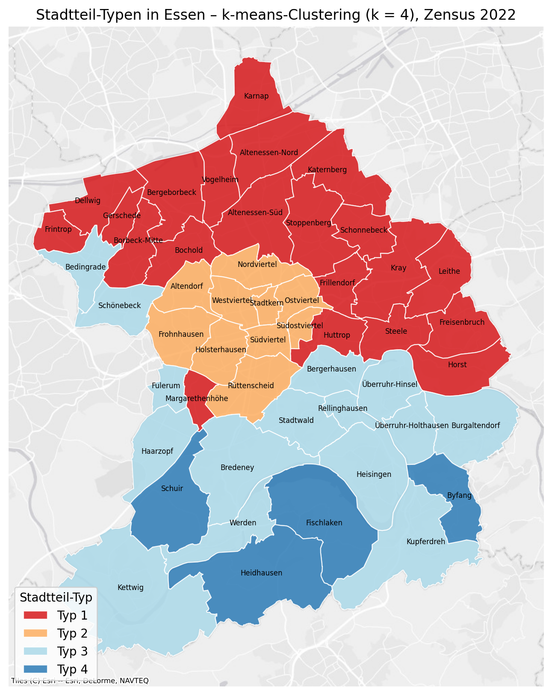
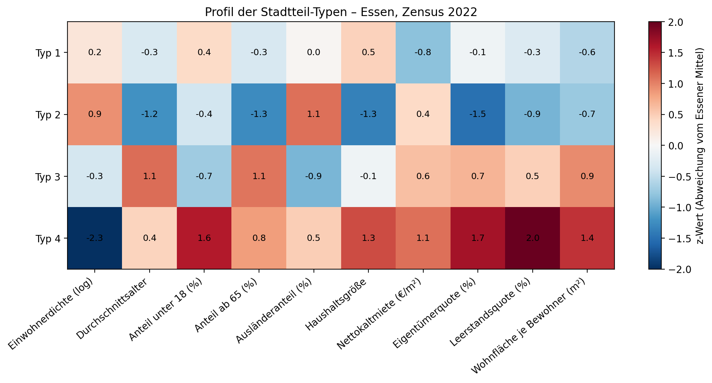

# Neighbourhood Types in Essen – Clustering with Census 2022

[English](#neighbourhood-types-in-essen--clustering-with-census-2022) | [Deutsch](#deutsch)

Multivariate **k-means clustering** of the **50 districts (*Stadtteile*) of Essen (NRW, Germany)**, based on 100 m grid data of the official **German Census 2022 (*Zensus 2022*)**. Ten demographic and housing variables are aggregated to the districts, standardised and grouped into **four district types**, which show a clear north–south pattern across the city.



---

## Key results

| | |
|---|---|
| Study area | Essen – 50 districts, 570,607 inhabitants |
| Data | Census 2022, 100 m grid cells (10 variables) |
| Method | k-means, k = 4 (best silhouette score 0.33 for k = 3–7) |

**The four district types (mean values)**

| Type | Districts | Inhabitants | Avg. age | Foreigners | Net rent | Owner rate | Living space / person | Short description |
|---|---|---|---|---|---|---|---|---|
| 1 | 21 | 259,630 | 43.1 | 20.5 % | 6.2 €/m² | 37 % | 47 m² | North and east: affordable residential districts, larger households |
| 2 | 10 | 153,610 | 39.7 | 31.8 % | 7.2 €/m² | 16 % | 46 m² | Inner city: dense, young, small rental households |
| 3 | 15 | 142,301 | 48.4 | 10.4 % | 7.3 €/m² | 49 % | 57 m² | South: older population, home ownership, more space |
| 4 | 4 | 15,066 | 45.9 | 25.3 % | 7.7 €/m² | 65 % | 61 m² | Rural south: very low density, highest owner rate |



**Interpretation:** the clustering reproduces the well-known social divide of Essen along the A40 motorway. The districts north and east of the centre (type 1) have the lowest rents and the largest households. The inner city (type 2) is the youngest and most diverse area, with very few owner-occupied homes. South of the centre (types 3 and 4), the population is older, more people own their homes and have more living space, and rents are higher.

---

## Workflow

1. **District boundaries** – administrative boundaries (admin level 10) from OpenStreetMap; city and borough polygons removed → 50 districts
2. **Census data** – 10 grid datasets (100 m) downloaded from Destatis, only cells inside Essen kept
3. **Aggregation** – grid cells joined to districts (cell centre within district); population-weighted means per district, population density from total population and area
4. **Variables** – population density (log), average age, share under 18, share 65+, share of foreigners, household size, net rent, owner-occupancy rate, vacancy rate, living space per person
5. **Standardisation** – z-scores, so that all variables have the same weight
6. **k-means** – k = 3 to 7 tested; k = 4 chosen by the highest silhouette score; types ordered by average rent
7. **Maps and export** – map with Esri Light Gray basemap, profile heatmap, results as GeoPackage and CSV

## Limitations

- Census values are suppressed in grid cells with very few inhabitants; districts are calculated from the remaining cells
- Rent, ownership and vacancy are weighted by population, not by the number of dwellings
- k-means depends on the selected variables and on k; the silhouette score (0.33) shows a moderate cluster structure
- In very small districts, single large facilities can strongly influence the values (e.g. Schuir)

---

## Repository structure

```
Essen-Neighbourhood-Clustering/
├── notebooks/
│   └── essen_neighbourhood_clustering.ipynb
├── images/
│   ├── 01_Stadtteil_Typen_Essen.png
│   └── 02_Cluster_Profile.png
├── results/
│   ├── stadtteil_typen_essen.gpkg    # districts with all variables and cluster type
│   ├── stadtteil_typen_essen.csv
│   └── silhouette_scores.csv
├── requirements.txt
├── LICENSE
└── README.md
```

The notebook runs in Google Colab and downloads the data automatically.

## Tools

Python · pandas · GeoPandas · scikit-learn (k-means, silhouette score) · OSMnx · Matplotlib · contextily · Google Colab

## Data sources

Zensus 2022 – © Statistisches Bundesamt (Destatis), Datenlizenz Deutschland – Namensnennung – Version 2.0 (dl-de/by-2-0). District boundaries: © OpenStreetMap contributors (ODbL). Basemap: Esri World Light Gray Canvas.

## License

Code: MIT License – see [LICENSE](LICENSE)

---
---

# Deutsch

[English](#neighbourhood-types-in-essen--clustering-with-census-2022) | [Deutsch](#deutsch)

Multivariates **k-means-Clustering** der **50 Stadtteile von Essen (NRW)** auf Basis der 100-m-Gitterdaten des amtlichen **Zensus 2022**. Zehn Merkmale zu Bevölkerung und Wohnen werden auf die Stadtteile aggregiert, standardisiert und zu **vier Stadtteil-Typen** zusammengefasst, die ein deutliches Nord-Süd-Muster zeigen.


---

## Zentrale Ergebnisse

| | |
|---|---|
| Untersuchungsgebiet | Essen – 50 Stadtteile, 570.607 Einwohner |
| Daten | Zensus 2022, 100-m-Gitterzellen (10 Merkmale) |
| Methode | k-means, k = 4 (bester Silhouette-Wert 0,33 bei k = 3–7) |

**Die vier Stadtteil-Typen (Mittelwerte)**

| Typ | Stadtteile | Einwohner | Ø Alter | Ausländeranteil | Nettokaltmiete | Eigentümerquote | Wohnfläche je Bewohner | Kurzbeschreibung |
|---|---|---|---|---|---|---|---|---|
| 1 | 21 | 259.630 | 43,1 | 20,5 % | 6,2 €/m² | 37 % | 47 m² | Norden und Osten: günstige Wohnstadtteile, größere Haushalte |
| 2 | 10 | 153.610 | 39,7 | 31,8 % | 7,2 €/m² | 16 % | 46 m² | Innenstadt: dicht, jung, kleine Mieterhaushalte |
| 3 | 15 | 142.301 | 48,4 | 10,4 % | 7,3 €/m² | 49 % | 57 m² | Süden: ältere Bevölkerung, Wohneigentum, mehr Wohnfläche |
| 4 | 4 | 15.066 | 45,9 | 25,3 % | 7,7 €/m² | 65 % | 61 m² | Ländlicher Süden: sehr geringe Dichte, höchste Eigentümerquote |


**Interpretation:** Das Clustering bildet die bekannte soziale Teilung Essens entlang der A40 ab. Die Stadtteile im Norden und Osten (Typ 1) haben die niedrigsten Mieten und die größten Haushalte. Die Innenstadt (Typ 2) ist der jüngste und vielfältigste Bereich mit sehr wenig Wohneigentum. Südlich des Zentrums (Typ 3 und 4) ist die Bevölkerung älter, die Eigentümerquote und die Wohnfläche sind höher, ebenso die Mieten.

---

## Arbeitsablauf

1. **Stadtteilgrenzen** – Verwaltungsgrenzen (admin level 10) aus OpenStreetMap; Polygone für Stadt und Stadtbezirke entfernt → 50 Stadtteile
2. **Zensusdaten** – 10 Gitterdatensätze (100 m) von Destatis heruntergeladen, nur Zellen in Essen behalten
3. **Aggregation** – Zuordnung der Gitterzellen zu den Stadtteilen (Zellmittelpunkt im Stadtteil); bevölkerungsgewichtete Mittelwerte je Stadtteil, Einwohnerdichte aus Einwohnerzahl und Fläche
4. **Merkmale** – Einwohnerdichte (log), Durchschnittsalter, Anteil unter 18, Anteil ab 65, Ausländeranteil, Haushaltsgröße, Nettokaltmiete, Eigentümerquote, Leerstandsquote, Wohnfläche je Bewohner
5. **Standardisierung** – z-Werte, damit alle Merkmale gleich gewichtet sind
6. **k-means** – k = 3 bis 7 getestet; k = 4 nach dem höchsten Silhouette-Wert gewählt; Typen nach mittlerer Miete sortiert
7. **Karten und Export** – Karte mit Esri-Light-Gray-Grundkarte, Profil als Heatmap, Ergebnisse als GeoPackage und CSV

## Einschränkungen

- In Gitterzellen mit sehr wenigen Einwohnern sind die Zensuswerte gesperrt; die Stadtteile werden aus den übrigen Zellen berechnet
- Miete, Eigentümerquote und Leerstand sind nach Einwohnern gewichtet, nicht nach Zahl der Wohnungen
- k-means hängt von den gewählten Merkmalen und von k ab; der Silhouette-Wert (0,33) zeigt eine mittlere Clusterstruktur
- In sehr kleinen Stadtteilen können einzelne große Einrichtungen die Werte stark beeinflussen (z. B. Schuir)

---

## Werkzeuge

Python · pandas · GeoPandas · scikit-learn (k-means, Silhouette-Wert) · OSMnx · Matplotlib · contextily · Google Colab

## Datenquellen

Zensus 2022 – © Statistisches Bundesamt (Destatis), Datenlizenz Deutschland – Namensnennung – Version 2.0 (dl-de/by-2-0). Stadtteilgrenzen: © OpenStreetMap-Mitwirkende (ODbL). Grundkarte: Esri World Light Gray Canvas.

## Lizenz

Code: MIT-Lizenz – siehe [LICENSE](LICENSE)
